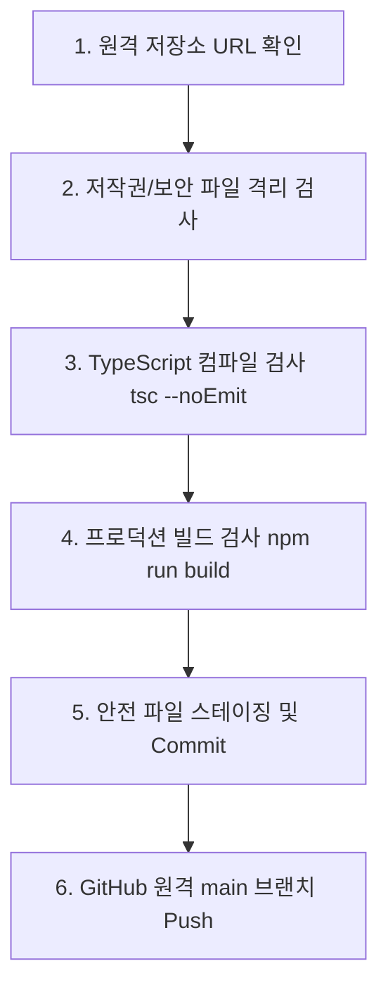

# GitHub 안전 자동 동기화 체계 및 운영 가이드

- **프로젝트명**: Booky — 영어 원서 읽기 & 회화 AI 코치
- **원격 저장소**: `https://github.com/anbyku251029-cmd/English-Reading`
- **대상 브랜치**: `main`
- **스크립트 경로**: `scripts/safe-git-sync.ps1`
- **작업 환경**: Windows PowerShell, Git for Windows

---

## 1. 개요 및 목적

Booky 프로젝트는 개발 효율성과 코드의 안전성을 동시에 보장하기 위해 **검증 기반의 자동 Git 동기화(Safe Git Sync)** 체계를 구축하였습니다.
단순히 파일을 푸시하는 것이 아니라, **저작권 보호**, **API 비밀키 유출 방지**, **코드 컴파일 및 빌드 무결성**을 자동으로 검증한 후 원격 저장소(`origin/main`)에 반영합니다.

---

## 2. 6단계 검증 게이트 (Security & Quality Gates)

`scripts/safe-git-sync.ps1` 실행 시 다음 6단계를 엄격하게 순차 실행합니다.



1. **원격 저장소 검증**: 지정된 GitHub 저장소(`anbyku251029-cmd/English-Reading`)와 정확히 일치하는지 확인합니다.
2. **저작권 및 보안 파일 격리 검증**:
   - 도서 원본(`Book/*.mobi`, `*.epub`, `*.pdf`)
   - 로컬 데이터베이스(`data/local_books/*.sqlite3`)
   - 환경 변수 및 비밀 키(`.env`, `.env.local`)
   - 백업 파일(`backup/`)
   - 위 항목이 Git 추적(Staging)에 절대 포함되지 않도록 사전 차단합니다.
3. **TypeScript 타입 무결성 검증 (`npx tsc --noEmit`)**:
   - 코드에 단 1건의 타입 에러라도 존재할 경우 동기화가 즉시 중단됩니다.
4. **프로덕션 빌드 무결성 검증 (`npm run build`)**:
   - 클라이언트 번들링 과정에서 문법 오류, 번들링 누락, 빌드 실패 발생 시 즉시 중단합니다.
5. **안전 스테이징 및 커밋 생성**:
   - 허용된 파일(`src/`, `scripts/`, `docs/`, `완료보고서/`, `reports/`, 설정 파일 등)만 명시적으로 스테이징하고 설명 메시지와 함께 커밋을 생성합니다.
6. **원격 저장소 Push**:
   - GitHub `origin/main`으로 안전하게 푸시하고, 완료 후 커밋 SHA를 보고합니다.

---

## 3. 실행 방법

PowerShell에서 아래와 같이 실행합니다:

```powershell
# 기본 동기화 실행
powershell -ExecutionPolicy Bypass -File .\scripts\safe-git-sync.ps1

# 커밋 메시지를 지정하여 실행 (권장)
powershell -ExecutionPolicy Bypass -File .\scripts\safe-git-sync.ps1 -CommitMessage "feat: add SQLite book reader API"
```

---

## 4. AI 에이전트(Antigravity) 상시 운영 규칙

AI 어시스턴트는 주요 마일스톤(단계별 작업 완료)이나 유의미한 코드 변경 후 다음 절차를 따릅니다:
1. 코드 수정 완료 및 로컬 동작 검증
2. `scripts/safe-git-sync.ps1` 스크립트를 통한 자동 동기화 실행
3. 생성된 커밋 SHA와 푸시 성공 여부를 완료 보고서에 반드시 명시
