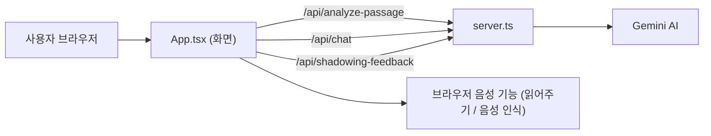

# 📋 완료 보고서 #01 — 프로그램 전체 검토

| 항목 | 내용 |
|---|---|
| 작업 일시 | 2026-10-27 20:10 ~ 20:16 |
| 작업 종류 | 코드 검토 + 실행 확인 (**코드는 한 줄도 고치지 않음**) |
| 대상 | `english-reading` (앱 이름: **Booky — 영어 원서 읽기 & 회화 AI 코치**) |

---

## 1. 이 프로그램은 무엇인가요? (한눈에 보기)

영어 원서(예: Magic Tree House)를 **챕터별로 읽고**, 문장을 **소리로 듣고**, **내 목소리로 따라 읽고(섀도잉)**, AI 코치 "Booky"에게 **피드백**을 받는 학습 앱이에요.

- **화면(프론트엔드)**: React + Tailwind (`src/` 폴더)
- **서버(백엔드)**: Express (`server.ts`) — Gemini AI에 질문을 대신 보내 줌
- **데이터**: 추천 원서 5권 (`src/data/presetBooks.ts`), Magic Tree House는 1~10장 수록

---

## 2. 제가 실제로 해 본 확인 결과

| 확인 항목 | 결과 | 쉬운 설명 |
|---|---|---|
| `npm install` (그대로 설치) | ❌ **실패** | 부품(패키지) 버전끼리 안 맞아서 설치가 안 돼요 (아래 🔴1번) |
| `npm install --legacy-peer-deps` | ✅ 성공 | 버전 충돌을 무시하는 옵션으로는 설치됨 |
| 타입 검사 (`tsc --noEmit`) | ✅ 오류 0개 | 코드 문법·타입은 깔끔해요 |
| 배포용 빌드 (`vite build`) | ✅ 성공 | 결과물 크기 **52.5MB** (대부분 안 쓰는 PDF 때문, 🟠5번) |
| 서버 실행 + 첫 화면 | ✅ 정상 (200) | |
| 채팅 API (API 키 없음) | ⚠️ 응답은 옴 | 오류를 숨기고 **미리 써둔 예시 답변**을 보여줌 (🟠3번) |
| 음성(TTS) API | ❌ 500 오류 | 다만 화면에서는 이 API를 아예 안 씀 (🟡) |

> 참고: 확인을 위해 `node_modules/`, `package-lock.json`, `dist/` 가 새로 생겼어요. 필요 없으면 지워도 됩니다.

---

## 3. 발견한 문제점 (중요한 순서)

### 🔴 꼭 고쳐야 할 것

**1. 설치가 바로 안 됨 — 패키지 버전 충돌**
- `package.json`의 `esbuild ^0.25.0` 과 `vite ^8.3.0`(esbuild 0.27 이상 필요)이 충돌해요.
- 👉 해결: `esbuild`를 `^0.27.0` 이상으로 올리거나, 직접 쓰지 않으니 **삭제**.

**2. AI 코치 채팅창이 화면에 안 나옴 (가장 큰 기능 누락)**
- [BookyChat.tsx](../src/components/BookyChat.tsx) 채팅 화면 부품이 만들어져 있지만 [App.tsx](../src/App.tsx)에서 **한 번도 화면에 붙이지 않았어요**.
- 그래서 앱이 시작할 때·섀도잉 후에 Booky에게 메시지를 보내고 답도 받지만, **사용자는 그 답을 볼 수 없어요.** (돈/할당량만 쓰고 결과는 안 보임)
- 같은 이유로 4단계(Step 1~4) 진행 기능도 화면에 나타나지 않아요. [Header.tsx](../src/components/Header.tsx)는 `currentStep`, `onSelectStep`을 받기만 하고 쓰지 않아요.
- 👉 해결: App 화면에 `BookyChat`을 붙이고(예: 오른쪽 패널 또는 탭), 헤더에 단계 표시 추가.

### 🟠 고치면 좋은 것

**3. AI 오류가 나도 "가짜 정답"이 나옴**
- [server.ts](../server.ts) 의 3개 API는 실패하면 **항상 Magic Tree House 1권 내용**으로 된 예시 답을 돌려줘요.
- 그래서 *어린 왕자*를 공부 중이어도 잭과 애니 이야기가 나오고, 섀도잉 점수는 무조건 **92점**이에요.
- API 키가 없어도 사용자는 "고장"인지 모르고 계속 써요.
- 👉 해결: 오류 시 "AI 연결 실패" 안내를 보여주거나, 최소한 예시 답임을 표시.

**4. AI 모델 이름 확인 필요**
- `gemini-3.8-flash`, `gemini-3.8-flash-lite-tts` 를 사용 중이에요. 실제로 쓸 수 있는 모델 이름인지 Google AI Studio에서 확인해 주세요. 틀리면 **항상 3번의 가짜 답만** 나와요.

**5. 안 쓰는 PDF 28개(약 55MB)가 공개 폴더에 있음**
- `public/assets/aistudio/*.pdf` 는 코드 어디에서도 쓰지 않아요.
- `public/` 폴더는 **누구나 주소만 알면 내려받을 수 있는 곳**이라, 저작권이 있는 책이 그대로 공개될 위험이 있어요. 빌드 결과물도 52MB로 커져요.
- 👉 해결: 다른 곳으로 옮기거나 삭제.

**6. 마이크 권한 거부 시 섀도잉 평가 불가**
- 마이크를 못 쓰면 "글로 입력하세요" 창은 뜨지만, 평가 버튼은 **녹음 파일이 있을 때만** 보여서 결국 평가를 못 받아요 ([BookPassageView.tsx](../src/components/BookPassageView.tsx) 208행, 769행).

**7. 학습자 레벨 설정이 첫 분석에 반영 안 됨**
- 설정에서 레벨을 바꿔도, 책/챕터를 고를 때는 책의 기본 레벨(`book.levelKey`)로 분석해요 ([App.tsx](../src/App.tsx) 81, 94행).

### 🟡 작은 문제 / 정리하면 좋은 것

| # | 내용 | 위치 |
|---|---|---|
| 8 | 설정의 **목소리 선택(Kore, Puck…)이 실제로 적용 안 됨**. 소리는 브라우저 기본 음성만 사용하고, 서버의 `/api/tts`는 쓰이지 않음 | `utils/audio.ts`, `SettingsModal.tsx` |
| 9 | 글자 크기 조절 버튼이 **같은 화면에 두 번** 나옴 | `BookPassageView.tsx` 266~294행, 472~524행 |
| 10 | 챕터 표시가 `/ 10`으로 고정 | `BookPassageView.tsx` 380행 |
| 11 | 녹음할 때마다 만든 음성 주소(`createObjectURL`)를 정리하지 않음 → 오래 쓰면 메모리 증가 | `BookPassageView.tsx` 191행 |
| 12 | 섀도잉 평가 요청에서 서버 오류(`res.ok`)를 확인하지 않음 | `BookPassageView.tsx` 238행 |
| 13 | `speakSentence`에서 `onend`를 두 번 지정(앞의 것은 무시됨) | `utils/audio.ts` 41, 52행 |
| 14 | 사용하지 않는 import/함수가 여러 개 (`fallbackWebSpeech`, 아이콘 등) | 여러 파일 |
| 15 | `clean` 스크립트가 `rm -rf`라 **Windows에서 동작 안 함** | `package.json` |
| 16 | 패키지 이름이 `react-example` 그대로, README도 AI Studio 기본 문구 | `package.json`, `README.md` |
| 17 | `vite.config.ts`의 `__dirname` 경고 → `import.meta.dirname` 권장 | `vite.config.ts` 11행 |
| 18 | 서버에 요청 횟수 제한이 없어, 공개 배포 시 누구나 내 API 할당량을 쓸 수 있음 | `server.ts` |
| 19 | Git 저장소가 아니라서 변경 이력·되돌리기가 불가능 | 프로젝트 폴더 |

---

## 4. 잘 되어 있는 점 👍

- 타입 오류 0개, 빌드 성공 — 코드 품질 기본기는 좋아요.
- API 키를 **서버에만** 두고 화면에는 노출하지 않는 구조 (보안상 올바름).
- 표현 노트가 `localStorage`에 저장되어 새로고침해도 남아요.
- 문장 클릭 → 그 문장부터 이어 읽기, 현재 문장 하이라이트·자동 스크롤 등 읽기 기능이 꼼꼼해요.
- 학습 노트를 마크다운(.md)으로 내보내기 가능.

---

## 5. 추천 다음 작업 순서

1. 🔴1 패키지 버전 고치기 → 누구나 `npm install` 가능하게
2. 🔴2 채팅창(BookyChat) 화면에 연결 → 앱의 핵심 기능 살리기
3. `.env.local`에 `GEMINI_API_KEY` 넣고 🟠4 모델 이름 확인
4. 🟠3 오류 안내 개선, 🟠5 PDF 정리
5. 🟡 작은 문제들 한 번에 정리

> 원하시면 위 순서대로 바로 수정 작업을 시작할게요. 각 작업이 끝날 때마다 이 폴더에 `완료보고서 #02, #03 …` 으로 이어서 저장하겠습니다.
